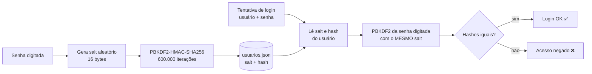

# Login com Proteção de Senha (PBKDF2 + Salt)

Pequena demonstração, em **Python puro (só biblioteca padrão)**, de um sistema de login que **nunca guarda a senha em texto puro**.

O programa permite:

- cadastrar um usuário com nome e senha;
- armazenar a senha de forma segura (salt + hash PBKDF2);
- fazer login informando usuário e senha;
- verificar se a senha informada corresponde à cadastrada.

Tudo está em um único arquivo: [`app.py`](app.py) (~100 linhas).

---

## Como executar

Requisito: Python 3.8+ (nada para instalar).

```bash
python3 app.py
```

```
=== Demo de Login Seguro ===
1) Cadastrar  2) Login  3) Ver arquivo  0) Sair
>
```

Os usuários ficam gravados em `usuarios.json` (criado automaticamente na primeira execução).

> ⚠️ O programa **imprime a senha digitada na tela** de propósito, apenas para fins didáticos (mostrar "como a senha chega na aplicação"). Um sistema real **nunca** faria isso nem gravaria a senha em logs.

---

## Fluxo da senha

```
 ┌─────────┐    ┌──────────────────────────┐    ┌────────────────────┐
 │  SENHA  │ ─► │  PROTEÇÃO CRIPTOGRÁFICA  │ ─► │   ARMAZENAMENTO    │
 │"abc123" │    │ salt aleatório + PBKDF2  │    │ usuarios.json:     │
 └─────────┘    │ (600.000 iterações)      │    │ salt + hash        │
                └──────────────────────────┘    └─────────┬──────────┘
                                                          │ lê salt + hash
 ┌──────────────────┐    ┌─────────────────────────────┐  │
 │ TENTATIVA DE     │ ─► │        VERIFICAÇÃO          │◄─┘
 │ LOGIN (senha)    │    │ PBKDF2(senha, mesmo salt)   │
 └──────────────────┘    │ == hash salvo ?  → OK / ERRO│
                         └─────────────────────────────┘
```

O mesmo fluxo em Mermaid (o GitHub renderiza automaticamente):



---

## Passo a passo (o que a atividade pede demonstrar)

### 1. Como a senha é recebida pela aplicação

```python
senha = getpass.getpass("Senha: ")
```

`getpass` lê a senha **sem exibi-la no terminal** (ninguém olhando por cima do ombro vê). Nesse momento a senha existe **apenas na memória** do programa, como uma string comum.

### 2. Como ela é transformada antes de ser armazenada

```python
salt = secrets.token_bytes(16)                       # 16 bytes aleatórios
hash_senha = hashlib.pbkdf2_hmac("sha256",
                                 senha.encode("utf-8"),
                                 salt,
                                 600_000)            # iterações
```

- **Salt**: um valor aleatório, diferente para cada usuário. Ele é misturado à senha antes do hash.
- **PBKDF2-HMAC-SHA256**: aplica o SHA-256 **600.000 vezes** em cadeia. Isso torna cada tentativa de adivinhação propositalmente lenta.
- O resultado é um **hash**: uma "impressão digital" de tamanho fixo (32 bytes) da qual **não é possível recuperar a senha** (função de mão única).

### 3. O que fica efetivamente armazenado

Exemplo real de `usuarios.json` depois de cadastrar `alice` e `bob`, **os dois com a mesma senha `minhaSenha123`**:

```json
{
  "alice": {
    "algoritmo": "pbkdf2_sha256",
    "iteracoes": 600000,
    "salt": "027e87bf4e6e93a67d3f703e3dc4fa0a",
    "hash": "e17bec7f2e8f60ae386942c38f104d1a882ccbb9e92da52adfb3d45b5354bb8c"
  },
  "bob": {
    "algoritmo": "pbkdf2_sha256",
    "iteracoes": 600000,
    "salt": "460b41602654104e3833121982738920",
    "hash": "193d476e2953c2014a93ceb21174490c9703131ff81ebab231387e6e60b301ee"
  }
}
```

Repare:

- a palavra `minhaSenha123` **não aparece em lugar nenhum**;
- mesmo com senhas iguais, os hashes são **completamente diferentes**, graças ao salt. Quem invadir o arquivo não consegue nem saber que os dois usam a mesma senha.

O algoritmo e o número de iterações também são guardados para que, no futuro, seja possível aumentar as iterações sem quebrar os usuários antigos.

### 4 e 5. Como o sistema verifica a senha no login

O sistema **não "descriptografa" nada** (hash não tem volta). Ele repete a mesma transformação e compara os resultados:

```python
salt = bytes.fromhex(registro["salt"])                          # salt salvo
hash_calculado = gerar_hash(senha, salt, registro["iteracoes"]).hex()
if hmac.compare_digest(hash_calculado, registro["hash"]):       # compara
    print("LOGIN OK")
```

Saída do programa com a senha **correta**:

```
[4] Tentativa de login: usuário='alice', senha digitada='minhaSenha123'
[5] Salt lido do arquivo:     027e87bf4e6e93a67d3f703e3dc4fa0a
[5] Hash armazenado:          e17bec7f2e8f60ae386942c38f104d1a882ccbb9e92da52adfb3d45b5354bb8c
[5] Hash da senha digitada:   e17bec7f2e8f60ae386942c38f104d1a882ccbb9e92da52adfb3d45b5354bb8c

Os hashes são iguais -> LOGIN OK ✅
```

Saída com a senha **errada**:

```
[4] Tentativa de login: usuário='alice', senha digitada='senhaErrada'
[5] Salt lido do arquivo:     027e87bf4e6e93a67d3f703e3dc4fa0a
[5] Hash armazenado:          e17bec7f2e8f60ae386942c38f104d1a882ccbb9e92da52adfb3d45b5354bb8c
[5] Hash da senha digitada:   ec96b55855d75170367aa9bf8587dac8e8cac90ff4acde8b66df784550d5c7cd

Os hashes são diferentes -> Usuário ou senha incorretos ❌
```

Basta errar um caractere para o hash mudar totalmente (efeito avalanche).

---

## Por que NÃO armazenar a senha original?

**Não é necessário:** para validar o login só precisamos saber se a senha digitada *gera o mesmo hash*. O sistema nunca precisa conhecer a senha em si.

**Não é recomendado:**

1. **Vazamento de banco** — se o arquivo/banco vazar (backup exposto, SQL injection, funcionário mal-intencionado), todas as senhas ficam expostas imediatamente. Com hash, o atacante só tem valores inúteis para login.
2. **Reuso de senha** — as pessoas repetem a senha em vários sites. Um vazamento em texto puro compromete o e-mail, o banco, as redes sociais da vítima.
3. **Ameaça interna** — nem o administrador do sistema deve conseguir ver a senha dos usuários.
4. **Legislação** — a LGPD exige medidas técnicas de segurança adequadas para dados pessoais; guardar senha em texto puro é uma falha grave.

---

## Decisões de projeto (e o porquê)

| Decisão | Por quê |
|---|---|
| **Python + só biblioteca padrão** | Roda em qualquer máquina com `python3 app.py`, sem `pip install`. Foco no conceito, não em dependências. |
| **Hash, e não criptografia reversível (AES etc.)** | Criptografia reversível exige uma chave; se a chave vazar junto com o banco, todas as senhas são reveladas. Hash não tem volta, então não existe chave para roubar. |
| **PBKDF2 em vez de SHA-256 puro** | SHA-256 é *rápido demais*: uma GPU testa bilhões de senhas por segundo. PBKDF2 com 600.000 iterações deixa cada tentativa ~600.000× mais cara, inviabilizando força bruta. É padrão NIST e recomendado pela OWASP. (Argon2 e bcrypt também são ótimas opções, mas exigiriam bibliotecas externas.) |
| **600.000 iterações** | Valor recomendado pela OWASP (2023) para PBKDF2-HMAC-SHA256. Para o usuário legítimo custa ~0,3 s; para quem testa milhões de senhas fica inviável. |
| **Salt aleatório de 16 bytes por usuário** | Impede o uso de *rainbow tables* (tabelas de hashes pré-calculados) e faz senhas iguais gerarem hashes diferentes. O salt **não é segredo**, por isso pode ficar salvo ao lado do hash. |
| **`secrets.token_bytes`** em vez de `random` | `secrets` usa o gerador criptograficamente seguro do sistema operacional; `random` é previsível. |
| **`hmac.compare_digest`** na comparação | Compara em tempo constante, evitando *timing attacks* (descobrir o hash pelo tempo que a comparação demora). |
| **`getpass`** para ler a senha | Não mostra a senha no terminal enquanto é digitada. |
| **Mensagem genérica "Usuário ou senha incorretos"** | Não revela ao atacante se o usuário existe ou não. |
| **Arquivo JSON como "banco"** | Fácil de abrir e mostrar exatamente o que fica armazenado. Em produção seria um banco de dados real. |
| **Algoritmo e iterações salvos junto do hash** | Permite aumentar as iterações no futuro sem invalidar contas antigas. |

---

## Estrutura

```
.
├── app.py       # todo o programa (cadastro, login, verificação)
├── README.md    # esta explicação
└── .gitignore   # ignora o usuarios.json gerado
```
